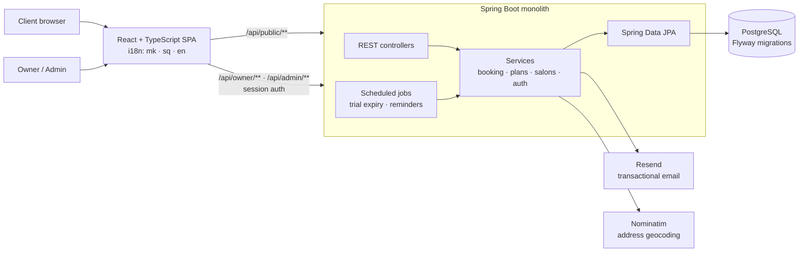

# Appointiko

**Online booking for beauty studios: replaces the paper appointment book.**

Nail, hair and makeup studios get a public booking page (shareable link + QR code) where clients pick a service and a free slot in seconds, plus a dashboard to manage services, working hours, days off and appointments. Built for the Macedonian market: Macedonian, Albanian and English UI, local phone validation, pricing in MKD.


<!-- TODO: replace with a 10–20s GIF: client books a slot → it appears in the owner dashboard -->


> **Live:** _TODO: add URL_ · **Built solo, end to end:** product, backend, frontend, deployment and operations.

---

## Features

**For clients (no account needed)**
- Public salon page at `/{slug}`: services, prices, durations, photos, working hours, map
- Real-time free slots for the chosen service and day, booking in a few taps
- Returning clients get their details pre-filled (remembered on their own device, never looked up server-side)
- **Explore** page: discover salons on a map (Leaflet + OpenStreetMap)

**For salon owners**
- Services, prices and durations; weekly schedule with **multiple working blocks per day** (e.g. 09–13, 15–19)
- **Calendar overrides** for holidays, days off and special hours, which take precedence over the weekly schedule
- Appointment list with cancel / complete / no-show, and manual bookings for walk-ins and phone calls
- Email notification for every new booking, shareable link and QR code for Instagram bios and the front desk
- Guided onboarding checklist

**For the business**
- Plan tiers (Free / Standard / Premium) with feature gating, 7-day trials, paid "boost" placement in Explore
- Scheduled jobs for trial expiry and plan reminder emails
- Admin console to activate plans and manage salons

<!-- TODO: screenshots -->
| Public booking page | Owner dashboard | Explore |
|---------------------|-----------------|---------|
|  |  |  |

---

## Architecture



The React app is built by `frontend-maven-plugin` and served from the same Spring Boot jar, so **one artifact, one container**. Deployed with Docker on Railway behind Cloudflare (DNS, WAF, custom domain).

---

## Key engineering decisions

- **No double bookings, even under concurrency.** Two clients can grab the same slot at the same moment. Booking runs in a transaction that first takes a **PostgreSQL advisory lock scoped to the salon** (`pg_advisory_xact_lock(salonId)`), then re-checks overlaps and working hours before inserting. Bookings for different salons never block each other.
- **The server re-validates everything.** The slot list shown to clients is only a hint. On booking, the backend re-checks that the service belongs to the salon and is active, the day is a working day, and the appointment fits fully inside a working block.
- **Overrides beat the weekly schedule.** Slot generation resolves a date-specific override first and falls back to the weekly schedule, with multiple blocks per day in both.
- **Feature gating in one place.** `PlanService` computes the effective tier (paid, trial or free) and answers capability questions (`canAddService`, `hasExploreAccess`, `hasNotificationAccess`). Controllers ask the service instead of checking plan names.
- **Schema as code.** 13 Flyway migrations with `ddl-auto: validate`, so Hibernate never mutates the production schema.
- **Pragmatic monolith.** One deployable with clear controller → service → repository layers. Right-sized for the product's stage, and easy to split later if needed.

---

## Tech stack

- **Backend:** Java 21, Spring Boot 3.5, Spring Web, Spring Security (session auth, cookie-to-header CSRF protection, BCrypt, role-based access), Spring Data JPA, Bean Validation (custom `@MacedonianPhone`), `@Scheduled` jobs, Lombok
- **Data:** PostgreSQL, Flyway; H2 in-memory for local dev and tests
- **Frontend:** React 18, TypeScript, Vite, React Router, i18next (mk / sq / en), Leaflet, QR code generation
- **Integrations:** Resend (email), Nominatim / OpenStreetMap (geocoding)
- **Testing:** JUnit 5, Spring Boot Test, Spring Security Test (booking, plans, reminders, salon management, auth security)
- **Deploy:** multi-stage Docker build, Railway, Cloudflare

---

## Run it locally

**Prerequisites:** JDK 21 (Node is downloaded automatically by the Maven build).

```bash
# Backend + bundled frontend, in-memory H2 database, no external services needed
./mvnw spring-boot:run -Dspring-boot.run.profiles=dev
# → http://localhost:8080

# Frontend with hot reload (proxies /api to :8080)
cd frontend && npm install && npm run dev
# → http://localhost:5173

# Tests
./mvnw test
```

**Production** (`prod` profile) reads its configuration from the environment:

| Variable | Purpose |
|----------|---------|
| `DATABASE_URL`, `DATABASE_USERNAME`, `DATABASE_PASSWORD` | PostgreSQL connection |
| `RESEND_API_KEY`, `RESEND_FROM` | Transactional email |
| `APP_BASE_URL` | Public URL used in links and emails |
| `APP_ADMIN_EMAIL` | Account granted the admin role |

```bash
docker build -t appointiko .
docker run -p 8080:8080 --env-file .env appointiko
```

---

## Project structure

```
src/main/java/org/appointiko/
├── controller/   # Public, Owner, Admin, Auth, Explore REST APIs
├── service/      # Booking, plans, salon management, notifications, scheduled jobs
├── model/        # JPA entities: Salon, Appointment, WorkingHours, Override, Plan…
├── repo/         # Spring Data repositories
├── dto/          # Request/response records
├── validation/   # @MacedonianPhone constraint
└── config/       # Security, web config, global exception handling
src/main/resources/db/migration/   # Flyway V1…V13
frontend/src/                      # React app: pages/{public,owner,admin}, i18n, API client
```

---

## What I'd do next

- **Staff-level calendars** so multi-chair salons can book a specific person
- **SMS reminders** to cut no-shows (most clients here prefer SMS/Viber over email)
- **Online payments** for plan subscriptions instead of manual activation
- **Rate limiting** on public booking endpoints

---

**Author:** Filip Popov · [LinkedIn](https://linkedin.com/in/filipopov) · filip.popov13@gmail.com
