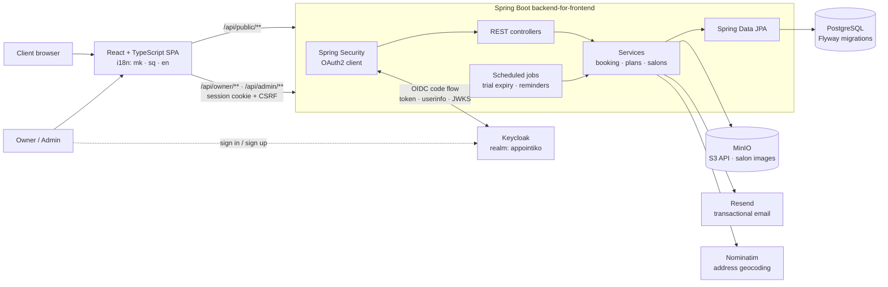

# Appointiko

**Online booking for beauty studios: replaces the paper appointment book.**

Nail, hair and makeup studios get a public booking page (shareable link + QR code) where clients pick a service and a free slot in seconds, plus a dashboard to manage services, working hours, days off and appointments. Built for the Macedonian market: Macedonian, Albanian and English UI, local phone validation, pricing in MKD.


<!-- TODO: replace with a 10–20s GIF: client books a slot → it appears in the owner dashboard -->


> **Live:** _TODO: add URL_ · **Built solo, end to end:** product, backend, frontend, deployment and operations.

---

## Features

**For clients (no account needed)**
- Public salon page at `/{slug}`: services, prices, durations, photos, working hours, map
- Real-time free slots for the chosen service and day, booking in a few taps
- Returning clients get their details pre-filled (remembered on their own device, never looked up server-side)
- **Explore** page: discover salons on a map (Leaflet + OpenStreetMap)

**For salon owners**
- Services, prices and durations; weekly schedule with **multiple working blocks per day** (e.g. 09–13, 15–19)
- **Calendar overrides** for holidays, days off and special hours, which take precedence over the weekly schedule
- Appointment list with cancel / complete / no-show, and manual bookings for walk-ins and phone calls
- Email notification for every new booking, shareable link and QR code for Instagram bios and the front desk
- Guided onboarding checklist

**For the business**
- Plan tiers (Free / Standard / Premium) with feature gating, 7-day trials, paid "boost" placement in Explore
- Scheduled jobs for trial expiry and plan reminder emails
- Admin console to activate plans and manage salons

<!-- TODO: screenshots -->
| Public booking page | Owner dashboard | Explore |
|---------------------|-----------------|---------|
|  |  |  |

---

## Architecture



The React app is built by `frontend-maven-plugin` and served from the same Spring Boot jar, so **one artifact, one container**. The full stack (app, PostgreSQL, Keycloak, MinIO) runs with Docker Compose for development and on **Kubernetes** via the manifests in [`deploy/`](deploy/) (local kind cluster).

---

## Key engineering decisions

- **No double bookings, even under concurrency.** Two clients can grab the same slot at the same moment. Booking runs in a transaction that first takes a **PostgreSQL advisory lock scoped to the salon** (`pg_advisory_xact_lock(salonId)`), then re-checks overlaps and working hours before inserting. Bookings for different salons never block each other.
- **Auth delegated to Keycloak, tokens never reach the browser.** The backend is the OIDC client (backend-for-frontend pattern): Keycloak handles sign-up, login, password reset and roles, Spring completes the authorization code flow, and the SPA only holds an HttpOnly session cookie. State-changing requests need a CSRF token (cookie-to-header). Logout also ends the Keycloak session (RP-initiated logout).
- **Keycloak roles map to app roles.** A realm-role mapper puts `roles` into the ID token; `OwnerOidcUserService` turns the `admin` realm role into `ROLE_ADMIN` and creates the local owner profile on first login, with salon setup as an onboarding step.
- **Images in object storage, not the database.** Salon photos go to MinIO through the AWS S3 SDK (path-style, so any S3-compatible store works); the database keeps only the object key. Images uploaded before the change are still served from their old rows.
- **Same manifests, two Keycloak URLs.** In Kubernetes the browser reaches Keycloak on its public URL while the app pod calls it on the service name. Keycloak issues tokens for the public hostname with dynamic backchannel URLs, and Spring is configured with separate browser-facing and server-to-server endpoints.
- **The server re-validates everything.** The slot list shown to clients is only a hint. On booking, the backend re-checks that the service belongs to the salon and is active, the day is a working day, and the appointment fits fully inside a working block.
- **Overrides beat the weekly schedule.** Slot generation resolves a date-specific override first and falls back to the weekly schedule, with multiple blocks per day in both.
- **Feature gating in one place.** `PlanService` computes the effective tier (paid, trial or free) and answers capability questions (`canAddService`, `hasExploreAccess`, `hasNotificationAccess`). Controllers ask the service instead of checking plan names.
- **Schema as code.** 15 Flyway migrations with `ddl-auto: validate`, so Hibernate never mutates the production schema.

---

## Tech stack

- **Backend:** Java 21, Spring Boot 3.5, Spring Web, Spring Security (OAuth2 client / OIDC login, cookie-to-header CSRF protection, role-based access), Spring Data JPA, Bean Validation (custom `@MacedonianPhone`), `@Scheduled` jobs, Lombok
- **Identity:** Keycloak 26 (realm-as-code import, realm roles, self-service registration)
- **Data & storage:** PostgreSQL, Flyway, MinIO via AWS SDK v2 (S3 API); H2 in-memory for local dev and tests
- **Frontend:** React 18, TypeScript, Vite, React Router, i18next (mk / sq / en), Leaflet, QR code generation
- **Integrations:** Resend (email), Nominatim / OpenStreetMap (geocoding)
- **Testing:** JUnit 5, Spring Boot Test, Spring Security Test (OIDC login, CSRF, roles), Mockito (booking, plans, reminders, salon management, image storage, onboarding)
- **Infrastructure:** multi-stage Docker build, Docker Compose, Kubernetes (Deployments, Services, PVCs, Secrets, kustomize), kind

---

## Run it locally

**Prerequisites:** JDK 21 and Docker (Node is downloaded automatically by the Maven build).

```bash
# 1. Keycloak (:8180) and MinIO (:9000, console :9001)
docker compose up -d

# 2. Backend + bundled frontend, in-memory H2 database
./mvnw spring-boot:run -Dspring-boot.run.profiles=dev
# → http://localhost:8080
#   owner@appointiko.local / owner   ·   admin@appointiko.local / admin   (or sign up)

# Frontend with hot reload (proxies /api and /oauth2 to :8080)
APP_FRONTEND_URL=http://localhost:5173 ./mvnw spring-boot:run -Dspring-boot.run.profiles=dev
cd frontend && npm install && npm run dev
# → http://localhost:5173

# Tests (no Docker needed)
./mvnw test
```

### On Kubernetes (local kind cluster)

```bash
./deploy/kind-up.sh                  # creates the cluster, builds + loads the image, applies deploy/
kind delete cluster --name appointiko
```

This runs the app with the `prod` profile against PostgreSQL, Keycloak and MinIO inside the cluster, on the same localhost ports as above. Stop `docker compose` first.

### Configuration (`prod` profile)

| Variable | Purpose |
|----------|---------|
| `DATABASE_URL`, `DATABASE_USERNAME`, `DATABASE_PASSWORD` | PostgreSQL connection |
| `KEYCLOAK_PUBLIC_URL` | Keycloak URL as seen by browsers |
| `KEYCLOAK_INTERNAL_URL` | Keycloak URL the backend calls (defaults to the public URL) |
| `KEYCLOAK_REALM`, `KEYCLOAK_CLIENT_ID`, `KEYCLOAK_CLIENT_SECRET` | OIDC client registration |
| `STORAGE_ENDPOINT`, `STORAGE_ACCESS_KEY`, `STORAGE_SECRET_KEY`, `STORAGE_BUCKET` | S3-compatible object storage |
| `RESEND_API_KEY`, `RESEND_FROM` | Transactional email (empty key disables email) |
| `APP_BASE_URL` | Public URL used in links and emails |
| `APP_FRONTEND_URL` | Only when the SPA is served from a different origin |
| `APP_ADMIN_EMAIL` | Receives boost requests |

---

## Project structure

```
src/main/java/org/appointiko/
├── controller/   # Public, Owner, Admin, Auth, Explore REST APIs
├── service/      # Booking, plans, salon management, notifications, scheduled jobs
├── model/        # JPA entities: Salon, Appointment, WorkingHours, Override, Plan…
├── repo/         # Spring Data repositories
├── dto/          # Request/response records
├── validation/   # @MacedonianPhone constraint
└── config/       # Security (OIDC, CSRF, logout), storage client, web config, error handling
src/main/resources/db/migration/   # Flyway V1…V15
frontend/src/                      # React app: pages/{public,owner,admin}, i18n, API client
deploy/
├── keycloak/realm-appointiko.json # realm, client, roles and demo users (imported on start)
├── k8s/                           # Deployments, Services, PVCs for app, PostgreSQL, Keycloak, MinIO
├── kustomization.yaml             # kubectl apply -k deploy/
└── kind-config.yaml, kind-up.sh   # local cluster
docker-compose.yml                 # Keycloak + MinIO for development
```

---

## What I'd do next

- **Staff-level calendars** so multi-chair salons can book a specific person
- **SMS reminders** to cut no-shows (most clients here prefer SMS/Viber over email)
- **Online payments** for plan subscriptions instead of manual activation
- **Rate limiting** on public booking endpoints
- **Migrate legacy password accounts into Keycloak** (import existing users with a required password reset)
- **Ingress + TLS** and a production-mode Keycloak with its own database for a real cluster

---

**Author:** Filip Popov · [LinkedIn](https://linkedin.com/in/filipopov) · filip.popov13@gmail.com
